# 🦅 Project Simorgh — the Agentic OS Edge Gateway

> «سی‌مرغ» از *منطق‌الطیر* عطّار نیشابوری: سی پرنده پس از سفری طولانی می‌فهمند که خودِ سی‌مرغ‌اند.
> *Thirty birds set out to find the Simorgh. The thirty survivors (si morgh) discover that they
> themselves — united — **are** the Simorgh.* — Attar of Nishapur, *The Conference of the Birds*

**Simorgh (سیمرغ)** is a free-to-run, no-KYC, self-evolving **agentic AI gateway** that stitches the
fragmented free tiers of the internet into one resilient, sovereign intelligence. The founding metaphor
is literal architecture: **many small "birds" (free-tier providers) fly together as one Simorgh, and
when one bird tires, the flock reroutes — with a `RouteReason` on every skip.**

> **Documentation method:** this repository documents itself with **OKF v0.3** (Open Knowledge Format):
> plain Markdown, YAML frontmatter (`type`, `sources`, `generated`, `verified`, `status`, `stale_after`),
> a bundle-root `index.md`, and a live TODO queue. Read `docs/index.md` first, then
> [`docs/ROADMAP-SPINE.md`](docs/ROADMAP-SPINE.md) → [`docs/STATE-OF-PROJECT.md`](docs/STATE-OF-PROJECT.md) → [`docs/todo/index.md`](docs/todo/index.md).

---

# 📗 بخش فارسی

## چکیده (TL;DR)

**سیمرغ چیست؟** یک گذرگاه (gateway) عامل‌مندِ (agentic) رایگان و بدون KYC که سهمیه‌های رایگانِ چند
مدل‌دهنده (provider) را به یک «گلّه» (flock) واحد متصل می‌کند و پاسخ را از سالم‌ترین پرندۀ بیدار
می‌گیرد. با **صفر کلید مخفی** هم بالا می‌آید (پرندۀ Homā روی Workers AI همیشه بیدار است) و وقتی
پرنده‌ای خسته یا مرده باشد، با ثبت یک `RouteReason` به پرندۀ بعدی می‌رود — نه خرابیِ خاموش، نه
جوابِ جعلی.

**وضعیت فعلی (۲۰۲۶-۱۱-۲۱):** موتور روتینگ، پراب‌های قابلیت، مدل Task، سنجش امنیت و **هویت principal
از credential (A3)** عرضه شده‌اند؛ بازیابی با **C1** (RetrievalPort + آداپترِ FTS5 بدون‌وابستگی) و
**C2** (چهار مسیرِ دانش: index/get/search/delete با provenance سطحِ قطعه، namespaceِ principal-محور،
re-index جایگزین) عرضه شد؛ ماژولِ بومیِ Rust (shieldِ خروجی، بر پایهٔ ADR-0010، پیش‌فرض خاموش و
سنجیده‌شده) هم اضافه شد. تست‌ها: **۱۹۳ workerd + ۵۶۱ Node سبز**، typecheck خروج ۰،
`platform:smoke` سبز (MCP نسخهٔ ۲۰۲۶-۰۷-۲۸). گامِ بعدی **B1** است: یکپارچه‌سازی Task/Schedule/Execution
تا هیچ سهمیه‌ای تا تأیید ظرفیت‌سنج خرج نشود (B2)، سپس بستن حلقهٔ usage (B3) و اولین تسکِ
durable انتها-به-انتها (B4).

**هزینه اجرا: ۰ دلار.** همۀ primitiveها روی تایر واقعاً رایگان و بدون کارت‌اند. **مجوز: MIT.**

## چشم‌انداز و استعاره

سیمرغ از *منطق‌الطیر* عطّار الهام می‌گیرد: سی پرنده که دنبال سیمرغ می‌روند و در پایان می‌فهمند خودشان
سیمرغ‌اند. در معماری این یعنی: **پرنده‌های کوچک (پروایدرهای رایگان) با هم پرواز می‌کنند و یکی که
خسته شد، گلّه مسیر را عوض می‌کند.** این استعاره، قاعدهٔ طراحی است نه تزئین: هیچ‌جا وابستگی به یک
پروایدر واحد وجود ندارد و «honest degradation» (افتِ صادقانه) یک تضمینِ معماری است.

## معماری — سه مؤلفه، یک جهتِ وابستگی

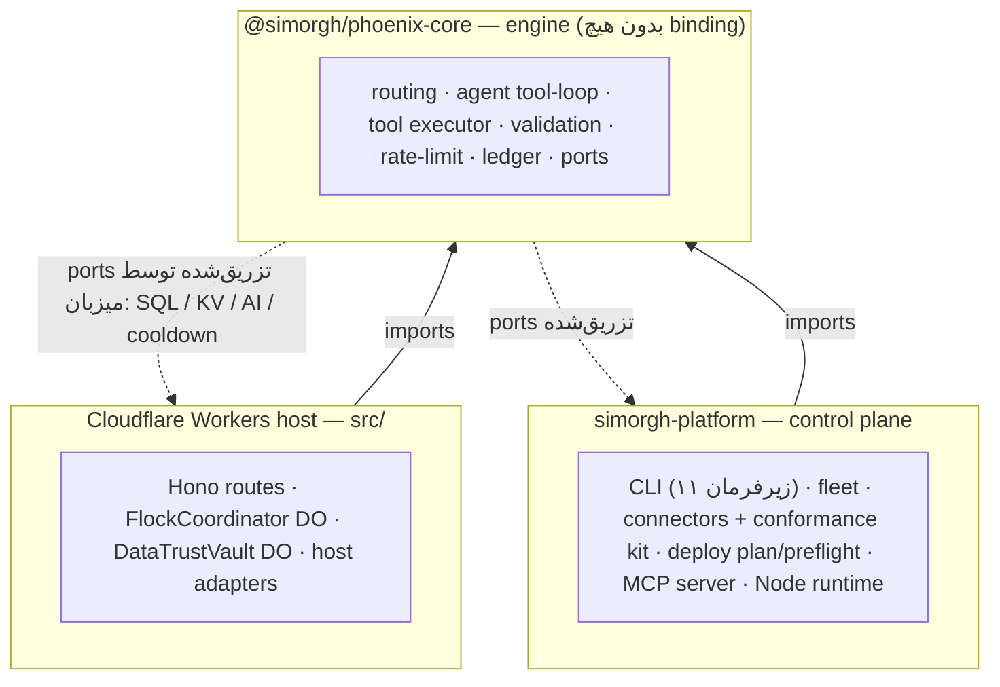

| بسته | مسیر | نقش |
|---|---|---|
| `@simorgh/phoenix-core` | `phoenix-core/` | موتور مستقل از زمان‌اجرا: روتینگ، حلقهٔ ابزار عامل، اعتبارسنجی، rate‌limit، ledger. **هیچ binding‌ی ندارد** — هر قابلیت به‌صورت port تزریق می‌شود. |
| `simorgh-platform` | `simorgh-platform/` | کنترل‌پلین: targetها، کانکتورهای REST/MCP + کیت انطباق، پلنِ deploy + preflight، fleet، سرور MCP خودش، و هستهٔ Nodefy. |
| اپ Cloudflare | `src/` (ریشه) | میزبان Workers: routeهای Hono، دو Durable Object و adapterهایی که موتور را به `Env` وصل می‌کنند. |

**قاعدهٔ مطلق و ماشینی:** `phoenix-core/test/boundary.test.ts` اگر موتور به `cloudflare:workers`،
ماژول `node:` بیرون از آداپترِ اعلام‌شده‌اش، یا globalِ زمان‌اجرا (`Response`، `crypto.`، `SqlStorage`…)
دست بزند، بیلد را fail می‌کند. موتور قابل حمل است **چون نمی‌تواند drift کند**.

## گلّه (The Flock) — هشت پرنده

هر پرنده یک پروایدر را به یک شکل نرمال می‌کند و به ترتیب priority (کمُ مقدار، اول) امتحان می‌شود.
پرنده تا وقتی کلیدش نباشد **dormant** می‌ماند؛ پس گ Gateway با **صفر کلید** اجرا می‌شود.

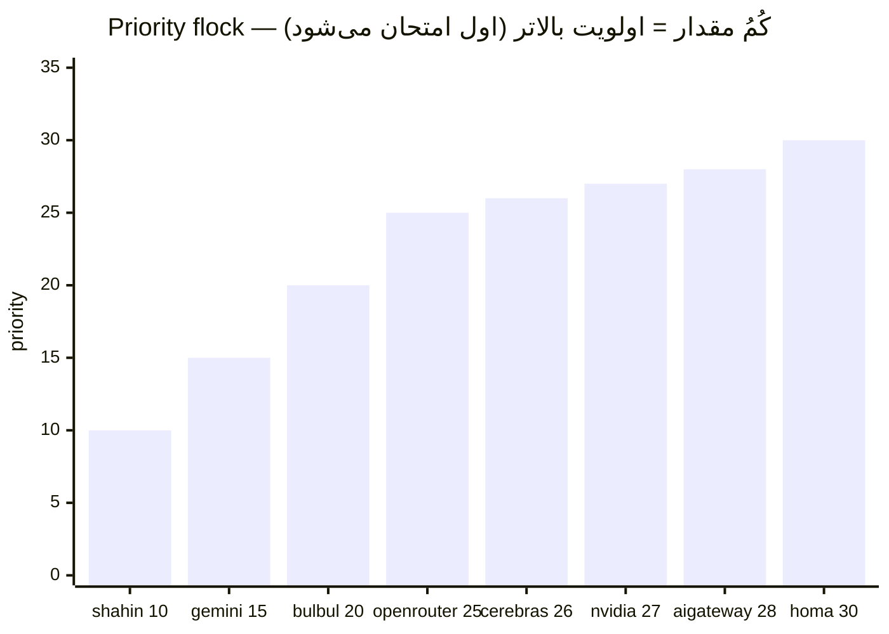

| id | پرنده | پروایدر | مدل | کلید | priority |
|----|------|----------|-----|------|----------|
| `shahin` | 🦅 Groq | Groq (سازگار با OpenAI) | `llama-3.3-70b-versatile` | `GROQ_API_KEY` | 10 — سریع‌ترین، اول |
| `gemini` | 🔮 Gemini | Google Generative Language | `gemini-2.5-flash` | `GEMINI_API_KEY` | 15 — تنها پرندۀ غیر-OpenAIشکل |
| `bulbul` | 🐦 HuggingFace | HuggingFace Router | `meta-llama/Llama-3.3-70B-Instruct` | `HF_TOKEN` | 20 |
| `openrouter` | 🌐 OpenRouter | OpenRouter (سازگار با OpenAI) | `openrouter/free` — استخر `:free` | `OPENROUTER_API_KEY` | 25 |
| `cerebras` | ⚡ Cerebras | Cerebras (سازگار با OpenAI) | `llama-3.3-70b` | `CEREBRAS_API_KEY` | 26 — **unclassified** |
| `nvidia` | 🟢 NVIDIA NIM | NVIDIA NIM (سازگار با OpenAI) | `meta/llama-3.3-70b-instruct` | `NVIDIA_API_KEY` | 27 — **unclassified** |
| `aigateway` | ▲ Vercel AI Gateway | Vercel AI Gateway (سازگار با OpenAI) | `meta/llama-3.3-70b-instruct` | `VERCEL_AI_GATEWAY_API_KEY` | 28 — **unclassified** |
| `homa` | 🕊️ Workers AI | Cloudflare Workers AI | `@cf/meta/llama-3.2-3b-instruct` | *هیچ* | 30 — **همیشه بیدار → تضمینِ صفر-KYC** |

سه پرنده cost classification ندارند؛ `FREE_ONLY` «نامعلوم» را «غیررایگان» می‌گیرد و ردشان می‌کند — این
عمدی است و دقیقاً همان چیزی است که تسکِ **E3** (پرنده‌های فقط-اعتبارسنجی) باید حل کند.

### وضعیت سلامتِ پرنده

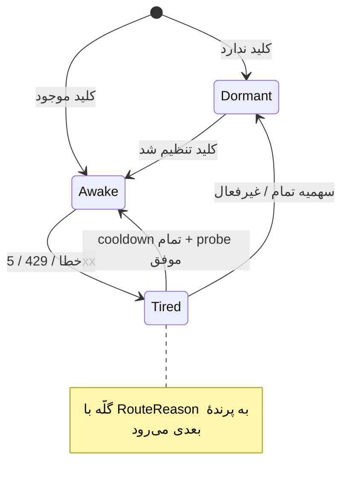

## ماژول‌ها — چه چیزی وارد می‌شود، چه چیزی نه

تصمیمِ کامل: [`ADR-0009`](docs/adr/ADR-0009-module-adoption-retrieval.md). قاعده: **پورت واحدِ ماژولاریته است، نه کتابخانه.**

| قابلیت | پایهٔ بدون‌وابستگی | آداپترِ اختیاری | رد‌شده |
|---|---|---|---|
| بازیابی / lexical | **SQLite FTS5** روی `SqlPort` (هر دو میزبان) | **Orama** (Apache-2.0، Node/local، vector/hybrid)؛ **Cloudflare AI Search** (مشروط، ۱۰۰۰+۱۰۰۰ پرس‌وجوی رایگان/ماه) | Meilisearch / Typesense / Qdrant (سرور)؛ sqlite-vec روی Workers (پشتیبانی‌نشده) |
| حافظه (C4) | SQLite + FTS5 + پاکتِ OKF | — | Mem0 / Graphiti / Neo4j (فهرست انجماد) |
| اجرای durable (B1–B4) | DO alarms + `scheduled.ts` | — | Temporal / Inngest / Trigger.dev / BullMQ |
| observability | console ساخت‌یافته + ledger (Workers)؛ `pino` (فقط Node) | — | collector در موتور |
| validation / CLI / MCP | دست‌نویس، بدون‌وابستگی | `zod` / `citty` / `@modelcontextprotocol/sdk` فقط در لایهٔ platform | هیچ‌کدام در `phoenix-core` |

**این نوبت عرضه شد:** `RetrievalPort` در `ports.ts`، `createFts5Retrieval` + `normalizeFtsQuery` + `mergeRetrievalHits` در `retrieval.ts`، و ۱۷ تست. `boundary.test.ts` سبز است چون ماژول فقط `./ports.ts` را import می‌کند.

## مسیر یک درخواست

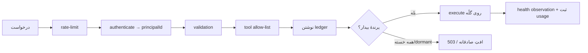

جزئیاتِ توالیِ یک `ask` با failover:

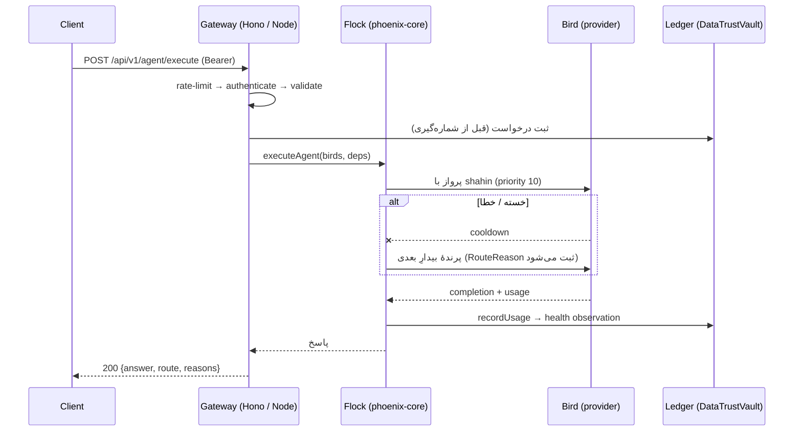

** نکته‌های طراحی که ارزش دانستن دارند:**

- **روتینگ به‌صورت تابعِ خالص تست می‌شود، نه از داخل Durable Object** — چون Homā در هر درخواست
  Workers AI را صدا می‌زند و Workers AI شبیه‌سازی محلی ندارد.
- **allow-list ابزار assert می‌شود، نه فرض** — `http.test.ts` درخواستی با ابزارِ غیرمجاز می‌فرستد و
  بررسی می‌کند Durable Object فقط ابزارهای مجاز را دیده است.
- **`/api/v1/flock/status` هرگز ۵۰۰ نمی‌دهد** — اگر DO در دسترس نباشد، آخرین snapshot از KV با
  `"source": "kv-cache"` و timestampِ اصلی جواب می‌دهد: کهنه و برچسب‌خورده، نه یک گلّهٔ اختراعی.
- **هویت از credential می‌آید (A3)** — `X-Simorgh-User-Id` و `userId`ِ بدنه فقط *ادعا* هستند؛ باید با
  subjectِ توکن بخوانند وگرنه `403`.

## سطح API (خلاصه)

| متد | مسیر | هدف |
|-----|-------|-----|
| `POST` | `/api/v1/agent/execute` | اجرای عامل (tool loop + failover گلّه) |
| `GET` | `/api/v1/flock/status` | Swarm-State زنده: کدام پرنده بیدار/خسته/dormant است |
| `GET` | `/api/v1/quota` | سطرِ quota هر حسابِ اعلام‌شده |
| `GET` | `/api/v1/capabilities` | این deployment واقعاً چه می‌تواند (bearer-gated) |
| `GET`/`POST` | `/api/v1/schedule` | scheduled flightها / زمان‌بندی پرامپت تا ۳۰ روز |
| `POST`/`GET`/`DELETE` | `/api/v1/knowledge` (+ `/search`) | دانشِ principal-محور: index، get، search (provenance سطحِ قطعه)، delete — روی FTS5 |
| `POST` | `/api/v1/telegram/webhook` | دروازهٔ چت تلگرام (با webhook secret راستی‌آزمایی می‌شود) |
| `POST` | `/api/v1/discord/webhook` | دروازهٔ چت دیسکورد (با امضای Ed25519) |
| `GET` | `/api/v1/user/:userId/logs` · `/api/v1/context/:refId` | Data-Trust: دفترِ شفافیت و payloadهای offload‌شده (fail-closed) |
| `GET` | `/dashboard` | Mission Control: setup، flock، platformها، scheduleها، quota، MCP و چت مستقیم |
| `GET` | `/health` | `{status, timestamp}` |

`POST /mcp` فقط توسط رانتایمِ **Node** mount می‌شود؛ کارگرِ مستقرشده `/mcp` ندارد.

### ابزارهای MCP

`simorgh_*` = یک هسته؛ `platform_*` = کلِ گلّه. این دو namespace نباید هیچ‌وقت ادغام شوند.

| ابزار | namespace | معنا |
|---|---|---|
| `simorgh_status` | یک هسته | سلامت و وضعیت گلّهٔ یک instance |
| `simorgh_ask` | یک هسته | پرسیدن از یک instance (به‌عنوان *action*؛ محتوا parse می‌شود) |
| `platform_targets` | گلّه | هسته‌ها کجا می‌توانند زندگی کنند |
| `platform_fleet` | گلّه | کدام instanceها ثبت شده‌اند، سلامت و پاسخ‌های اخیر |
| `platform_ask` | گلّه | پرسیدن از گلّه با failover |

## نقشهٔ مخزن (خلاصه)

```text
src/                  میزبان Cloudflare Workers — routeهای Hono، FlockCoordinator + DataTrustVault + KnowledgeVault DO، adapterها
phoenix-core/         @simorgh/phoenix-core — موتور مستقل از زمان‌اجرا + آداپتر node/ + دانش (knowledge.ts) و بازیابی (retrieval.ts)
simorgh-platform/     کنترل‌پلین: targets، connectors، deploy/preflight، fleet، سرور MCP، هستهٔ Node، CLI
packages/ gateway/ bot/ tools/   فضای کاری Go (config، crypto، ledger، providers؛ gatewayِ self-hosted؛ همراهان)
native/               ماژولِ بومیِ Rust (shieldِ خروجی، cdylib + Wasm صفر-import، C ABI) — اختیاری، پیش‌فرض خاموش (ADR-0010)
docs/                 باندل OKF v0.3: adr/ api/ design/ history/ prd/ research/ todo/ + ROADMAP-SPINE، STATE-OF-PROJECT، ARCHITECTURE…
android/              کلاینتِ بومیِ Android (Agent/Status/Config) روی قراردادِ REST
qwenone/ mailbox/     درخت‌های محلیِ فضای کاری؛ بیرون از قراردادِ هسته
```

جزئیات کامل: [`docs/ARCHITECTURE.md`](docs/ARCHITECTURE.md) و بخش Repository Map در نسخهٔ انگلیسی.

## این پروژه کجا می‌رود؟ (Roadmap)

ستون فقراتِ اجراییِ شمالی (north star) — یک spineِ واحد، بدون فریم‌ورکِ جدید:


### وضعیت فازها

```mermaid
flowchart LR
    subgraph done["✅ انجام‌شده"]
        P0["0 · Foundation — موتور، ports"]
        P1["1 · Routing — pickRoute، complexity"]
        P2["2 · Capability — probeها + /capabilities"]
        P3["3 · Task model — DAG + persistence"]
        PA3["A3 · هویت principal از credential"]
    end
    subgraph active["🚧 فعال"]
        P4["4 · Durable execution — quota-gated (B1–B4)"]
    end
    subgraph next["⏭ بعدی"]
        P5["5 · Retrieval — C1+C2 تمام‌شده، C3/C4 بعدی"]
        P6["6 · Memory (C4)"]
        P7["7 · Autonomous loop (D1)"]
    end
    subgraph later["🗓 بعدتر"]
        P8["8 · Connectors (F2)"]
        P9["9 · UI / PWA (F3)"]
    end
    done --> active --> next --> later
```

**ترتیب صفِ زنده** (`docs/todo/index.md`): `A3 ✅ → C1 ✅ → C2 ✅ → B1 → B2 → B3 → B4 → C3 → E1 → G2 → G3 → C4 → D1 → E2 → E3`.

**ماژول‌ها (ADR-0009) و سیاستِ بومی (ADR-0010):** پایهٔ بازیابی FTS5 است؛ Orama اختیاری و AI Search مشروط است. ماژول‌های Rust فقط به‌صورت شتاب‌دهندهٔ اختیاریِ پشتِ port، با تستِ دیفرانسیلی و اندازه‌گیری‌شده و پیش‌فرض خاموش (shieldِ خروجی ۱.۵–۱.۷× کندتر از V8 سنجیده شد — هستهٔ Rust همچنان رد است).

- **B1–B4 (فعال):** یکپارچه‌سازی Task/Schedule/Execution، بستن حلقهٔ quota admission و usage، و
  اولین تسکِ durableِ انتها-به-انتها. قاعدۀ طلایی: **هیچ سهمیه‌ای تا capacity planner نگفته «می‌توانی»
  خرج نمی‌شود.**
- **C1 ✅ + C2 ✅:** RetrievalPort + آداپترِ FTS5، و API دانش با chunking، provenance سطحِ قطعه و
  namespaceِ principal-محور عرضه شد. **C3–C4:** namespaceهای agent و حافظهٔ لایه‌ای (working → task →
  episodic → knowledge → semantic → procedural).
- **D1:** اولین کارِ واقعیِ swarm — «خلاصهٔ تحقیقِ چندمنبعی»: Goal → کشف منابع → fetch×N ∥ بازیابی دانش →
  مقایسه → سنتز → بازبینی → نوشتن در حافظه.
- **E1–E3:** مدرن‌سازی MCP (نسخهٔ نهایی ۲۰۲۶-۰۷-۲۸: stateless + Tasks)، کشفِ پروایدر، و پرنده‌های
  فقط-اعتبارسنجی (Gemini + OpenRouter `:free`) با rows هزینگی کامل.
- **G2–G3 (۲۰۲۶ levers):** الحاقِ gatewayِ Go به قراردادِ هسته (SSE + کلیدهای مهرشده) و داشبورد به‌صورتِ
  MCP Apps (`ui://`).
- **F (بعد از اثبات B–D):** sharding، sync کانکتورها، PWA، و benchmark برای انتخاب durable-execution.

### فهرست انجماد (چه چیزهایی هرگز ساخته نمی‌شوند)

```text
❌ هستهٔ Rust/Wasm          (ADR-0010: رد؛ ماژول‌های بومی فقط optional/پیش‌فرض‌خاموش/سنجیده‌شده)
❌ وابستگی‌های غول‌پیکر حافظه (Mem0 / Graphiti / Neo4j)
❌ تعقیبِ «۲۰ پروایدر بیشتر»   (گسترش = داده از discovery/probe، نه کد)
❌ دومین task DB / دومین scheduler
❌ فقط-Cloudflare (self-host درجه‌یک می‌ماند)
❌ credential استخرشدهٔ رایگان و ساختِ خودکارِ حساب (BYOK-first)
❌ مهاجرت به Vercel، PWA غول‌پیکر، موتورِ policy غول‌پیکر
🟡 همراه Go: در سطح انطباق فریز شده (build/test سبز) — G2 آن را به هسته تبدیل می‌کند
```

## روش مستندسازی — OKF v0.3

همهٔ سندهای این مخزن با **OKF v0.3** نوشته می‌شوند: Markdown خالص + frontmatter یاملی با
`type`، `sources` (مسیرهایی که resolve می‌شوند)، `generated/by|at`، `verified`، `status`
(`draft`/`stable`/`deprecated`) و `stale_after`. `index.md` ریشهٔ باندل است و `docs/` زیردستِ آن.
قوانین کامل: [`docs/index.md`](docs/index.md). هر ادعای رفتارِ جاری یا به کد/تست اشاره می‌کند یا
منبع دارد؛ اگر سند و کد اختلاف داشته باشند، **کد می‌برد**.

## شروع سریع

```bash
upm install            # نصب وابستگی‌ها (upm؛ upm.lock متعهد است)
upm run typecheck      # TypeScript 7 (tsgo) — سه کانفیگ
upm run dev            # miniflare → http://127.0.0.1:8787/dashboard (Homā بدون کلید کار می‌کند)
upm run simorgh -- serve --port 8788   # هستهٔ Node محلی — first-class، بدون حساب و کارت
upm run deploy         # wrangler deploy با گیتِ typecheck
upm test               # هر دو سویت (workerd + node)
```

سه جا برای اجرا: **Cloudflare** (مسیر اختیاری)، **Node محلی** (درجه‌یک)، و **box میزبانِ
self-hosted**. جزئیات و تله‌ها: [`docs/DEPLOY.md`](docs/DEPLOY.md).

## تست

**وضعیت فعلی (۲۰۲۶-۱۱-۲۱):** ۱۹ فایلِ workers / ۱۹۳ تست و ۳۰ فایلِ node / ۵۶۱ تست سبز؛ typecheck خروج ۰؛ `platform:smoke` سبز.

| سویت | کانفیگ | چه چیزی را اثبات می‌کند |
|---|---|---|
| `workers` | `vitest.config.ts` | اپِ Cloudflare **داخل workerd**: Durable Object RPC، KV واقعی، شکلِ cron، قراردادهای route. کاملاً hermetic — بدون حساب و بدون درخواستِ خروجی. |
| `node` | `vitest.node.config.ts` | موتور در انزوا (routing، tool loop، ledger، validation، rate limit، ناورداهای حمل‌پذیری) + پلتفرم (targets، connectors، deploy، fleet، doctor). SQLite واقعی در حافظه. |

`phoenix-core/test/boundary.test.ts` همان دلیلی است که این جدایی اهمیت دارد: اگر موتور binding بگیرد،
سویتِ node قرمز می‌شود در حالی‌که workers سبز می‌ماند. همین سیگنال، هدف است.

---

# 📘 English

## TL;DR

**What is Simorgh?** A free-to-run, no-KYC **agentic AI gateway** that federates the free tiers of
several model providers into one "flock" and answers through the healthiest awake bird. It boots with
**zero secrets** (Homā on Workers AI is always awake) and when a bird tires or dies it reroutes with a
recorded `RouteReason` — never a silent failure, never a fabricated answer.

**Current state (2026-11-20):** routing, capability probes, the task model, security hardening and
**principal-identity-from-credential (A3)** have shipped; suites are **188 workerd + 539 Node green**,
typecheck exit 0, all 8 Go modules green. Retrieval (C1) started with a zero-dependency FTS5 adapter behind a new RetrievalPort; C2 routes are next. The next step is **B1**: unify Task/Schedule/Execution so
**no quota is spent until the capacity planner says it can** (B2), then close the usage loop (B3) and
land the first end-to-end durable task (B4).

**Cost to run: $0.** Every primitive sits on a genuinely free, no-credit-card tier. **License: MIT.**

## Vision and metaphor

Simorgh is named after Attar of Nishapur's *Conference of the Birds*: thirty birds journey to find the
Simorgh and discover they themselves — united — are it. In architecture this is literal: **many small
"birds" (free-tier providers) fly as one Simorgh, and when one bird tires the flock reroutes.** The
metaphor is a design rule, not decoration: no single-provider dependency exists anywhere, and honest
degradation is a framework guarantee.

## Architecture — three components, one-way dependency

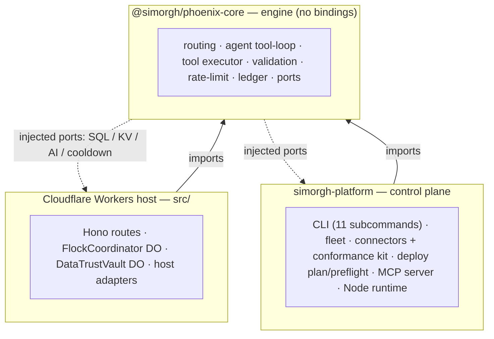

| Package | Path | What it does |
|---------|------|--------------|
| `@simorgh/phoenix-core` | `phoenix-core/` | Runtime-agnostic engine: provider routing, agent tool loop, request validation, rate limiting, ledger. **No runtime bindings** — every capability arrives as an injected port. |
| `simorgh-platform` | `simorgh-platform/` | Control plane: deployment targets, REST/MCP connectors + conformance kit, deploy plans + preflight gate, fleet management, its own MCP server, and the self-hosted Node core. |
| the Cloudflare app | `src/` (root) | The Workers host: Hono routes, the FlockCoordinator and DataTrustVault Durable Objects, and host adapters binding the engine to `Env`. |

**The rule is absolute and machine-enforced.** `phoenix-core/test/boundary.test.ts` fails the build if
the engine reaches for `cloudflare:workers`, any `node:` module outside its one declared adapter, or a
bare runtime global (`Response`, `crypto.`, `SqlStorage`, …). The engine is portable *because it cannot
drift*.

## The Flock — eight birds

Each "bird" normalizes a provider to one shape and is tried in priority order (lower first). A bird
stays **dormant** until its key is present, so the gateway runs with **zero secrets**.

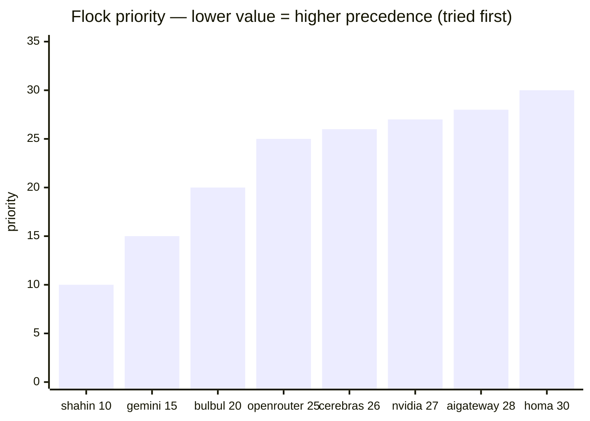

| id | Bird | Provider | Model | Key | Priority |
|----|------|----------|-------|-----|----------|
| `shahin` | 🦅 Groq | Groq (OpenAI-compat) | `llama-3.3-70b-versatile` | `GROQ_API_KEY` | 10 — fastest, first |
| `gemini` | 🔮 Gemini | Google Generative Language | `gemini-2.5-flash` | `GEMINI_API_KEY` | 15 — the one bird that is *not* OpenAI-shaped (ARCHITECTURE.md §1.1) |
| `bulbul` | 🐦 HuggingFace | HuggingFace Router | `meta-llama/Llama-3.3-70B-Instruct` | `HF_TOKEN` | 20 |
| `openrouter` | 🌐 OpenRouter | OpenRouter (OpenAI-compat) | `openrouter/free` — a router over the `:free` pool | `OPENROUTER_API_KEY` | 25 |
| `cerebras` | ⚡ Cerebras | Cerebras (OpenAI-compat) | `llama-3.3-70b` | `CEREBRAS_API_KEY` | 26 — **unclassified** |
| `nvidia` | 🟢 NVIDIA NIM | NVIDIA NIM (OpenAI-compat) | `meta/llama-3.3-70b-instruct` | `NVIDIA_API_KEY` | 27 — **unclassified** |
| `aigateway` | ▲ Vercel AI Gateway | Vercel AI Gateway (OpenAI-compat) | `meta/llama-3.3-70b-instruct` | `VERCEL_AI_GATEWAY_API_KEY` | 28 — **unclassified** |
| `homa` | 🕊️ Workers AI | Cloudflare Workers AI | `@cf/meta/llama-3.2-3b-instruct` | *none* | 30 (**always present → zero-KYC guarantee**) |

Three birds carry no cost classification; `FREE_ONLY` treats "unknown" as "not free" and refuses them —
deliberate, and exactly what task **E3** (evidence-gated validation birds) exists to fix.

### Bird health states

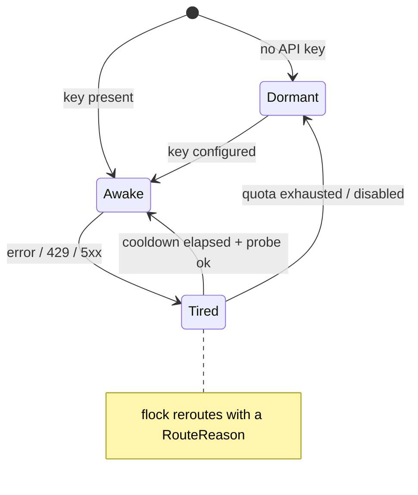

## Modules — what is adopted, and what is refused

Full decision: [`ADR-0009`](docs/adr/ADR-0009-module-adoption-retrieval.md). The rule: **the port is the modularity unit, not the library.**

| Capability | Baseline (zero-dep) | Optional adapter | Refused |
|---|---|---|---|
| retrieval / lexical | **SQLite FTS5** over `SqlPort` (both hosts) | **Orama** (Apache-2.0, Node/local, vector/hybrid); **Cloudflare AI Search** (conditional, 1k+1k free queries/mo) | Meilisearch / Typesense / Qdrant (servers); sqlite-vec on Workers (unsupported) |
| memory (C4) | SQLite + FTS5 + OKF envelope | — | Mem0 / Graphiti / Neo4j (freeze list) |
| durable execution (B1–B4) | DO alarms + `scheduled.ts` | — | Temporal / Inngest / Trigger.dev / BullMQ |
| observability | structured console + ledger (Workers); `pino` (Node only) | — | collector in the engine |
| validation / CLI / MCP | hand-rolled, dependency-free | `zod` / `citty` / `@modelcontextprotocol/sdk` in the platform layer only | any of these in `phoenix-core` |

**Shipped this pass:** `RetrievalPort` in `ports.ts`, `createFts5Retrieval` + `normalizeFtsQuery` + `mergeRetrievalHits` in `retrieval.ts`, and 17 tests. `boundary.test.ts` stays green because the module imports only `./ports.ts`.

## The request path

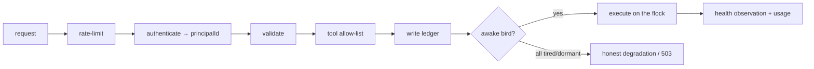

Sequence of one `ask` with failover:

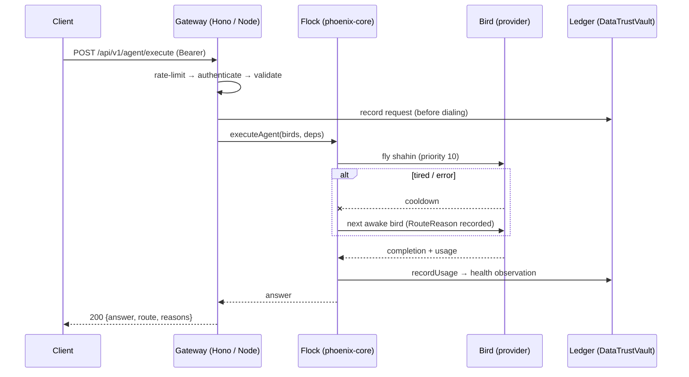

**Design notes worth knowing:**

- **Routing is tested as a pure function, not through the Durable Object** — Homā calls Workers AI on
  every request and Workers AI has no local simulation, so DO-driven routing tests would need the real
  internet (and bill for it). `flyFlock()` takes birds, env and cooldown lookup as arguments.
- **The tool allow-list is asserted, not assumed** — `http.test.ts` sends a request with disallowed
  tools and checks the Durable Object received only the allow-listed ones.
- **`/api/v1/flock/status` never 500s** — if the DO is unreachable, the last KV snapshot answers with
  `"source": "kv-cache"` and its original timestamp: stale and labelled, never an invented flock.
- **Identity comes from the credential (A3)** — `X-Simorgh-User-Id` and body `userId` are *claims*;
  they must match the token's subject or the answer is `403`.

## API surface (summary)

| Method | Route | Purpose |
|--------|-------|---------|
| `POST` | `/api/v1/agent/execute` | Run the agent (tool loop + flock failover). |
| `GET`  | `/api/v1/flock/status` | Live Swarm-State: which birds are awake/tired/dormant (KV-cached fallback). |
| `GET`  | `/api/v1/quota` | Every declared account's quota row, over RPC from the DO. |
| `GET`  | `/api/v1/capabilities` | What this deployment can actually do (bearer-gated). |
| `GET`/`POST` | `/api/v1/schedule` | Scheduled flights / schedule a prompt (up to a 30-day horizon). |
| `POST`/`GET`/`DELETE` | `/api/v1/knowledge` (+ `/search`) | Principal-scoped knowledge: index, get, search (passage-level provenance), delete — over FTS5. |
| `POST` | `/api/v1/telegram/webhook` | Telegram chat gateway (shared-secret verified before parsing). |
| `POST` | `/api/v1/discord/webhook` | Discord chat gateway (Ed25519 signature verified). |
| `GET`  | `/api/v1/user/:userId/logs` · `/api/v1/context/:refId` | Data-Trust ledger and offloaded payloads (fail-closed, per-user). |
| `GET`  | `/dashboard` | Mission Control: setup, overview, flock, platforms, schedules, quota, tools/MCP, direct chat. |
| `GET`  | `/health` | `{status, timestamp}`. |

`POST /mcp` is mounted by the **Node** runtime only; the deployed Worker has no `/mcp`.

### MCP tools

`simorgh_*` = one core; `platform_*` = the whole fleet. Different namespaces — never aliased.

| Tool | Namespace | Meaning |
|---|---|---|
| `simorgh_status` | one core | Health and flock state of a single instance |
| `simorgh_ask` | one core | Ask one instance — an *action*, so its content is parsed |
| `platform_targets` | fleet | Where cores can be deployed |
| `platform_fleet` | fleet | Which instances are recorded, health and recent answers |
| `platform_ask` | fleet | Ask the fleet, with failover |

## Repository map (detail)

```text
simorgh-platform/
├── phoenix-core/           # @simorgh/phoenix-core — engine (ports, routing, agent, validation)
│   ├── src/                # ports.ts, flock.ts, agent.ts, security.ts, execute.ts, health.ts, rate-limit.ts, models.ts, provider.ts, retrieval.ts
│   │   └── node/           # Node adapter: nodeSqlPort, createNodePorts, memoryContextStore, sqlLedger
│   └── test/               # engine tests
├── simorgh-platform/       # control plane (imports phoenix-core; nothing imports it)
│   ├── src/                # targets, connectors (rest/mcp) + conformance kit, deploy, fleet, mcp/server, runtimes (node/smoke), cli, doctor
│   └── scripts/            # e2e-ask.ts — the CLI reaching a live core over REST *and* MCP
├── src/                    # the Cloudflare host — Hono routes, DO shells, host adapters
├── test/                   # the workerd suite
├── native/                 # Rust workspace: the output shield (cdylib + zero-import Wasm + C ABI) — optional, default OFF (ADR-0010)
├── packages/               # Go workspace: config, crypto (AES-256-GCM, argon2id), ledger, providers (+ providers/groq)
├── gateway/  bot/  tools/  # Go: self-hosted gateway binary + companions
├── android/                # native Android client (Agent/Status/Config) on the REST contract
├── index.md                # OKF bundle root
├── docs/                   # adr/ api/ design/ history/ prd/ research/ todo/ + ROADMAP-SPINE, STATE-OF-PROJECT, ARCHITECTURE, DEPLOY…
├── worker-configuration.d.ts  # GENERATED by `wrangler types` — do not edit
├── env.d.ts                # hand-written secrets (both Env interfaces)
├── go.work                 # Go workspace root
├── tsconfig.json           # TypeScript 7 (tsgo), strict, noEmit
└── wrangler.toml           # bindings: AI, KV(CONTEXT_STORE), DOs, cron, CORS_ORIGINS
```

## Where the project is going (roadmap)

The northern-star execution spine — one spine, no new frameworks:


### Phase ledger

```mermaid
flowchart LR
    subgraph done["✅ done"]
        P0["0 · Foundation — engine, ports"]
        P1["1 · Routing — pickRoute, complexity"]
        P2["2 · Capability — probes + /capabilities"]
        P3["3 · Task model — DAG + persistence"]
        PA3["A3 · principal from credential"]
    end
    subgraph active["🚧 active"]
        P4["4 · Durable execution — quota-gated (B1–B4)"]
    end
    subgraph next["⏭ next"]
        P5["5 · Retrieval — C1+C2 done, C3/C4 next"]
        P6["6 · Memory (C4)"]
        P7["7 · Autonomous loop (D1)"]
    end
    subgraph later["🗓 later"]
        P8["8 · Connectors (F2)"]
        P9["9 · UI / PWA (F3)"]
    end
    done --> active --> next --> later
```

**Live queue order** (`docs/todo/index.md`): `A3 ✅ → C1 ✅ → C2 ✅ → B1 → B2 → B3 → B4 → C3 → E1 → G2 → G3 → C4 → D1 → E2 → E3`.

**Modules (ADR-0009) and native policy (ADR-0010):** retrieval's baseline is FTS5; Orama is optional and AI Search conditional. Rust modules are optional accelerators behind ports — differentially tested, measured, default OFF (the shield measured 1.5–1.7× slower than V8; the Rust/Wasm core stays rejected).

- **B1–B4 (active):** unify Task/Schedule/Execution; wire quota admission and usage reconciliation;
  land the first durable end-to-end task. Golden invariant: **nothing spends provider quota until the
  capacity planner says it can.**
- **C1 ✅ + C2 ✅:** `RetrievalPort` + the FTS5 adapter, and the knowledge API with chunking,
  passage-level provenance and principal-scoped namespaces. **C3–C4:** agent namespaces and layered
  memory (working → task → episodic → knowledge → semantic → procedural).
- **D1:** the swarm's first real job — a multi-source research digest: Goal → discover sources →
  fetch×N ∥ retrieve prior knowledge → compare → synthesize → verify → write back.
- **E1–E3:** MCP modernization (the final 2026-07-28 revision: stateless core + Tasks), provider
  discovery, and evidence-gated validation birds (Gemini + OpenRouter `:free`) with full cost rows.
- **G2–G3 (2026 levers):** converge the Go gateway on the core contract (SSE + sealed keys) and the
  dashboard as an MCP Apps (`ui://`) resource.
- **F (only after B–D prove out):** sharding, connector sync, PWA, and a Workflows-vs-DO benchmark.

### Freeze list (what will not be built)

```text
❌ Rust/Wasm core          (ADR-0010: rejected; native modules are optional/default-OFF/measured only)
❌ Giant-memory deps (Mem0 / Graphiti / Neo4j)
❌ 20-more-provider chase   (expansion = data through discovery/probe, not code)
❌ Second task DB / second scheduler
❌ Cloudflare-only substrate (self-host stays first-class)
❌ Pooled free credentials & autonomous account creation (BYOK-first)
❌ Vercel migration, giant policy engine, giant PWA
🟡 Go companion: frozen at conformance level (build/test green) — G2 turns it into a core
```

## Documentation method — OKF v0.3

Every doc in this repo is written in **OKF v0.3** (Open Knowledge Format): plain Markdown + YAML
frontmatter with `type`, `sources` (paths that resolve), `generated/by|at`, `verified`, `status`
(`draft`/`stable`/`deprecated`) and `stale_after`. The bundle root is the repo root (`index.md`), and
`docs/` is its subdirectory. Full rules: [`docs/index.md`](docs/index.md). Every claim about current
behavior names code/tests or carries a source; when doc and code disagree, **the code wins**.

## Quick start

```bash
upm install            # install dependencies (upm; upm.lock is committed)
upm run typecheck      # TypeScript 7 (tsgo) — three configs
upm run dev            # miniflare → http://127.0.0.1:8787/dashboard (Homā works with no secrets)
upm run simorgh -- serve --port 8788   # local Node core — first-class, no account, no card
upm run deploy         # typecheck-gated wrangler deploy
upm test               # both suites (workerd + node)
```

Three places to run: **Cloudflare** (the optional path), a **local Node** core (first-class), and a
**self-hosted box**. Full detail, traps and free-plan ceilings: [`docs/DEPLOY.md`](docs/DEPLOY.md).

## Testing

**Current (2026-11-21):** 19 workers files / 193 tests and 30 node files / 561 tests green; typecheck exit 0; `platform:smoke` green.

| Suite | Config | What it proves |
|---|---|---|
| `workers` | `vitest.config.ts` | The Cloudflare app *inside workerd*: Durable Object RPC, real KV, the cron shape, route contracts. Fully hermetic — no account, no outbound request. |
| `node` | `vitest.node.config.ts` | The engine in isolation (routing, tool loop, ledger, validation, rate limiting, portability invariants) + the platform (targets, connectors, deploy, fleet, doctor). Real in-memory SQLite. |

`phoenix-core/test/boundary.test.ts` is why the split matters: if the engine ever picks up a binding,
the node suite goes red while the workers suite keeps passing — that signal is the point.

## License & ethos

Open-source (MIT), built for *"the greater good"* — a free agentic OS anyone can run. Data sharing is
**always opt-in**, encrypted, and PII-scrubbed. Safe-by-default is a framework guarantee, not a policy
afterthought.

*Si morgh → Simorgh. Thirty birds → one.* 🔥